<!--
  Group deck: ISLR/P Chapter 6.2 "Shrinkage Methods".
  Each speaker adds their slides in their own section below, in speaking order.
  Shared styling is in styles.css; put figures in figures/.
  Preview with: quarto preview slides.qmd
-->

<!-- ===================== Speaker 1: add slides here ===================== -->

<!-- ===================== Speaker 2: add slides here ===================== -->

<!-- ===================== Added slides: Lasso and Ridge foundations ===================== -->

## Why introduce the lasso? {.smaller}

::: {.fragment}
Ridge regression shrinks coefficient estimates toward zero, but generally does not set them exactly to zero.
:::

::: {.fragment}
- Ridge therefore typically retains all $p$ predictors, even when only a subset may be important.
- This can make interpretation difficult when $p$ is large.
- The lasso uses an absolute-value penalty and can set some coefficient estimates exactly to zero.
:::

::: {.fragment .result}
**Main distinction:** ridge shrinks coefficients; lasso shrinks coefficients and can select variables.
:::

::: notes
Ridge makes coefficients smaller but normally leaves every predictor in the model. The lasso can make coefficients exactly zero, producing a simpler model.
:::

## The lasso objective {.smaller}

The lasso coefficient estimates minimize

$$
\hat{\boldsymbol\beta}^{L}_{\lambda}
=\arg\min_{\boldsymbol\beta}\left\{RSS+\lambda\sum_{j=1}^{p}|\beta_j|\right\}.
$$

::: {.columns}
::: {.column width="34%"}
**RSS**

$$RSS=\sum_{i=1}^{n}\left(y_i-\beta_0-\sum_{j=1}^{p}\beta_jx_{ij}\right)^2$$

Measures squared prediction errors on the training data.
:::
::: {.column width="33%"}
**L1 penalty**

$$\lambda\sum_{j=1}^{p}|\beta_j|$$

Penalizes the total absolute size of the slope coefficients.
:::
::: {.column width="33%"}
**Tuning parameter $\lambda$**

- Larger $\lambda$: stronger penalty and more shrinkage.
- Smaller $\lambda$: weaker penalty.
:::
:::

::: {.fragment .result}
The intercept $\beta_0$ is not included in the penalty.
:::

::: notes
The lasso balances training RSS against a penalty on the absolute values of the slope coefficients. Lambda controls the strength of the penalty.
:::

## Figure 6.6 — Lasso coefficient paths {.smaller}

::: {.center}
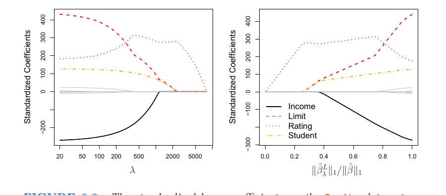{width="88%"}
:::

[The standardized lasso coefficients for the Credit data set are shown against $\lambda$ and the ratio of the lasso coefficient norm to the least-squares coefficient norm.]{.caption .center}

::: {.fragment .result}
At $\lambda=0$, the lasso gives the least-squares fit. When $\lambda$ is sufficiently large, all coefficient estimates become zero (the null model).
:::

::: notes
The left panel shows coefficient paths as lambda increases. In the right panel, the predictors enter as the model moves from strong shrinkage toward the least-squares fit. For this Credit example, rating enters first; student and limit enter nearly together, followed by income. This order is specific to this data set.
:::

## Reading the coefficient paths {.smaller}

- As $\lambda$ increases, coefficient magnitudes shrink; at a sufficiently large value, all coefficients are zero.
- The order in which predictors enter is data-dependent.
- In the Credit example, rating enters first; student and limit enter almost simultaneously; income follows.
- Different values of $\lambda$ can therefore produce models with different numbers of predictors.

::: {.fragment .result}
Unlike lasso, ridge regression generally keeps all predictors in the model, although their coefficient magnitudes shrink.
:::

::: notes
The entry order shown in the figure is not a universal rule. It depends on the data set and should not be generalized to every lasso fit.
:::

## Equivalent constrained formulations {.smaller}

The lasso can also be written as

$$
\min_{\boldsymbol\beta} RSS
\quad\text{subject to}\quad
\sum_{j=1}^{p}|\beta_j|\le s.
$$

Ridge regression can be written as

$$
\min_{\boldsymbol\beta} RSS
\quad\text{subject to}\quad
\sum_{j=1}^{p}\beta_j^2\le s.
$$

::: {.columns}
::: {.column width="50%"}
**Lasso: coefficient-size budget**

The sum of absolute coefficient values must not exceed $s$.
:::
::: {.column width="50%"}
**Ridge: squared-coefficient budget**

The sum of squared coefficient values must not exceed $s$.
:::
:::

::: {.fragment .result}
A smaller $s$ imposes a tighter restriction. For each value of $\lambda$, a corresponding $s$ can give the same estimates under the equivalent constrained formulation.
:::

::: notes
This s is a coefficient-magnitude budget. It is different from the s used in best subset selection, where s limits the number of nonzero coefficients.
:::

## Connection to best subset selection {.smaller}

$$
\min_{\boldsymbol\beta} RSS
\quad\text{subject to}\quad
\sum_{j=1}^{p} I(\beta_j\ne 0)\le s.
$$

- $I(\beta_j\ne0)=1$ if $\beta_j$ is nonzero; it is $0$ if $\beta_j=0$.
- The sum counts the number of nonzero coefficients, so $s$ limits how many predictors may be included.
- This is best subset selection: find the lowest-RSS model with at most $s$ predictors.
- Exhaustively checking all possible subsets becomes computationally infeasible when $p$ is large.

::: {.fragment .result}
The $s$ in this formula counts predictors. It is not the same as the lasso's $s$, which limits the sum of absolute coefficient values.
:::

::: notes
The indicator is a counting device: it returns one for a nonzero coefficient and zero for a zero coefficient. Best subset selection searches combinations of predictors under the count constraint.
:::

## Figure 6.7 — Constraint regions and RSS contours {.smaller}

::: {.center}
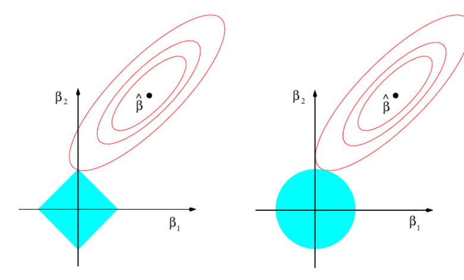{width="80%"}
:::

[The blue regions are the constraints; the red ellipses are contours of RSS. The solution is the first point at which an RSS contour touches the constraint region.]{.caption .center}

::: {.fragment .result}
The lasso's diamond has sharp corners on the axes; the ridge circle has a smooth boundary.
:::

::: notes
As the RSS ellipses expand away from the least-squares estimates, RSS increases. The constrained solution is the first point of contact between an ellipse and the allowed region.
:::

## Why the geometry matters {.smaller}

::: {.columns}
::: {.column width="50%"}
**Lasso: diamond**

$$|\beta_1|+|\beta_2|\le s$$

- The corners lie on the axes.
- The RSS contour can touch a corner.
- A coefficient can then be exactly zero, excluding its predictor.
:::
::: {.column width="50%"}
**Ridge: circle**

$$\beta_1^2+\beta_2^2\le s$$

- The boundary is smooth.
- The RSS contour generally touches away from the axes.
- Coefficients are generally nonzero, though they may be small.
:::
:::

::: {.fragment .result}
Lasso can perform feature selection because it can set coefficients exactly to zero; ridge generally shrinks without eliminating predictors.
:::

::: notes
The lasso does not always set coefficients to zero; the geometry makes this possible. The result also depends on the data and penalty strength.
:::

## Extending the geometry to more predictors {.smaller}

- $p=2$: the lasso constraint is a diamond; the ridge constraint is a circle.
- $p=3$: the lasso constraint becomes a polyhedron; the ridge constraint becomes a sphere.
- $p>3$: the lasso constraint becomes a polytope; the ridge constraint becomes a hypersphere.

::: {.fragment .result}
The key idea remains the same: the sharp corners of the lasso constraint make exact-zero coefficients possible, including multiple zeros at once in higher dimensions.
:::

::: notes
In higher dimensions, a lasso solution can lie on a face, edge, or corner where one or more coefficients equal zero. Ridge's smooth constraint boundary generally yields nonzero coefficient estimates.
:::

<!-- ===================== End added Lasso and Ridge foundations ===================== -->

<!-- ===== Speaker 3: Furkan Danisman, "Comparing ridge and lasso" (pp. 247-252) ===== -->

## Ridge or lasso: which predicts better? {.smaller}

The lasso yields sparser, more interpretable models. Does it also predict better?

::: {.fragment}
*It depends.* Neither method dominates the other in general.
:::

::: {.columns}
::: {.column width="30%" .fragment}
**Case 1: simulation design**

- $n = 50$ observations
- $p = 45$ predictors
- [**All 45**]{.num} predictors related to the response
- Ridge and lasso fitted over a grid of $\lambda$
- Squared bias, variance and test MSE recorded for each fit
:::
::: {.column width="70%" .fragment}
::: {.panels}
::: {.panel}
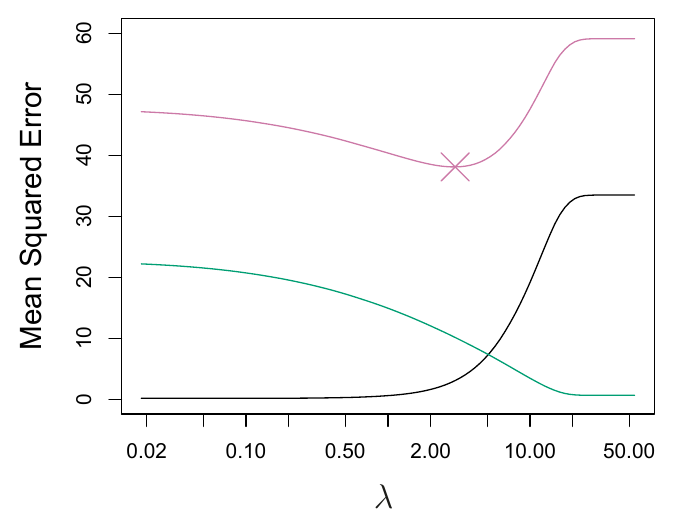{width="100%"}

more shrinkage → <small>(larger λ)</small>

[(a) Lasso only, against $\lambda$]{.panel-label}
:::
::: {.panel .fragment}
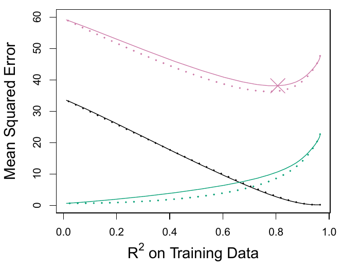{width="100%"}

← more shrinkage <small>(larger λ, higher bias)</small>less shrinkage → <small>(smaller λ, higher variance)</small>

[(b) Lasso (solid) vs ridge (dotted), against training $R^2$]{.panel-label}
:::
:::

[Squared bias (black), variance (green), test MSE (purple). Source: ISLP, Fig. 6.8.]{.caption}
:::
:::

::: {.fragment .result}
**Result:** similar bias, but ridge has slightly lower variance, and therefore lower test MSE.
:::

::: notes
- The lasso gives simpler models that use only some of the predictors. But what about accuracy?
- Answer: it depends.
- Case 1 uses the same simulated data as the ridge slides (Fig 6.5): n = 50, p = 45, and no true coefficient is zero.
- Panel (a): the lasso alone. As lambda grows, variance falls and bias rises, just like ridge.
- Panel (b): the x-axis is R^2 on the training data. Each point is one fitted model (one lambda). Ridge's lambda and the lasso's lambda don't mean the same thing, so we line models up by how well they fit the training data instead. Left = heavy shrinkage (poor fit), right = barely any shrinkage (close to least squares). At the same training fit, compare test MSE.
- Note the two axes run in opposite directions: in (a) shrinkage increases to the right, in (b) it decreases to the right.
- Ridge has slightly lower variance and so a slightly lower minimum MSE.
- Why? The lasso implicitly assumes that many coefficients are zero, and here none are.
:::

## Case 2: only a few predictors matter {.smaller}

Same simulation, with one change: the response depends on only two predictors.

::: {.columns}
::: {.column width="30%" .fragment}
**Case 2: simulation design**

- $n = 50$ observations
- $p = 45$ predictors
- Only [**2 of 45**]{.num} predictors related to the response
- Ridge and lasso fitted over a grid of $\lambda$
- Squared bias, variance and test MSE recorded for each fit
:::
::: {.column width="70%" .fragment}
::: {.panels}
::: {.panel}
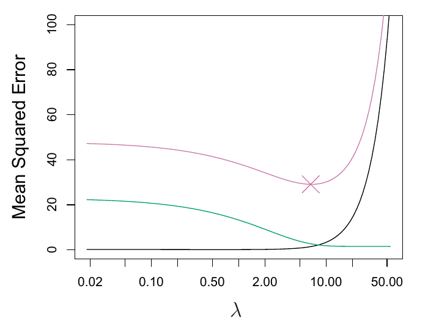{width="100%"}

more shrinkage → <small>(larger λ)</small>

[(a) Lasso only, against $\lambda$]{.panel-label}
:::
::: {.panel .fragment}
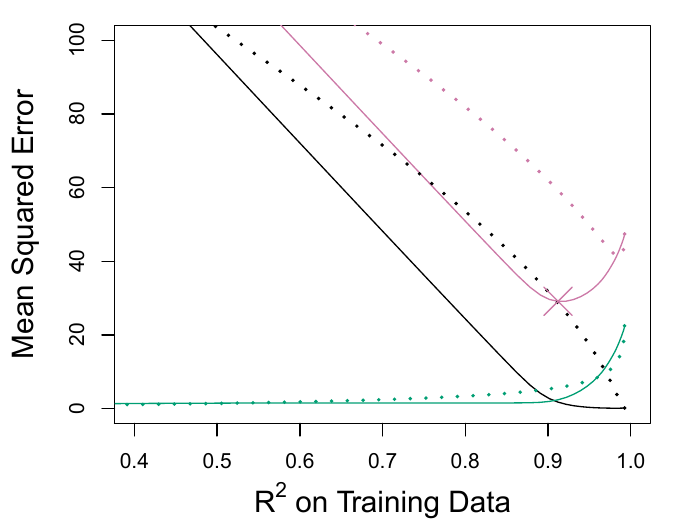{width="100%"}

← more shrinkage <small>(larger λ, higher bias)</small>less shrinkage → <small>(smaller λ, higher variance)</small>

[(b) Lasso (solid) vs ridge (dotted), against training $R^2$]{.panel-label}
:::
:::

[Squared bias (black), variance (green), test MSE (purple). Source: ISLP, Fig. 6.9.]{.caption}
:::
:::

::: {.fragment .result}
**Result:** the lasso now outperforms ridge in bias, variance and test MSE.
:::

::: notes
- Before showing the figure, ask the class: "Only 2 of the 45 predictors matter. Which method do you expect to win?"
- Everything else is identical to Case 1; only the number of non-zero coefficients changes (45 → 2).
- Now the lasso's implicit assumption (many coefficients are exactly zero) matches the truth.
:::

## Why? It depends on the true coefficients {.smaller}

::: {.columns}
::: {.column width="50%" .center}
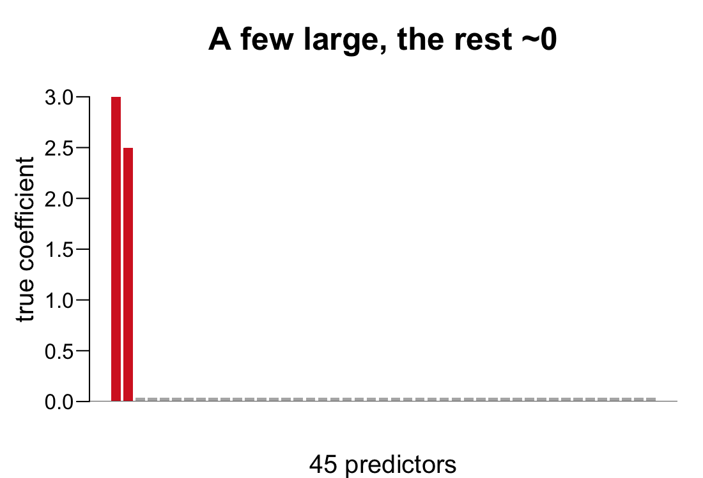{height="250px"}

::: {.fragment}
Few large coefficients, the rest near zero 
→ **lasso** expected to do better
:::
:::
::: {.column width="50%" .center}
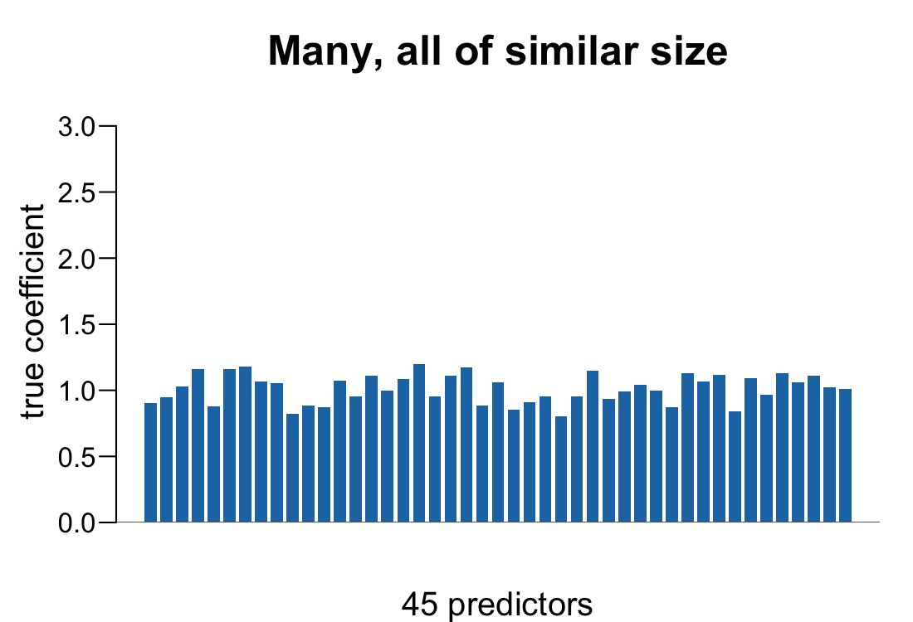{height="250px"}

::: {.fragment}
Many coefficients of similar size 
→ **ridge** expected to do better
:::
:::
:::

[These examples are for illustrative purposes, and not taken directly from the book.]{.caption .center}

::: {.fragment .result}
**Problem:** however, on real data, the number of predictors related to the response is never known *a priori*.
:::

::: {.fragment}
**One possible approach:** use cross-validation to determine which method performs better on a particular data set.
:::

::: notes
- Lasso: a small number of predictors have substantial coefficients and the rest are very small or zero.
- Ridge: the response depends on many predictors, all with coefficients of roughly equal size.
- Problem first: on a real data set we don't know how many predictors matter. Pause here.
- Then one possible approach: cross-validation, comparing the two methods on the data at hand (the next speaker covers selecting lambda with CV).
- (These bar charts are illustrations, not book data.)
:::

## A simple special case: two kinds of shrinkage {.smaller}

::: {.columns}
::: {.column width="30%" .fragment}
**Set-up** (p. 249)

- $n = p$, $\mathbf{X} = I$, no intercept
- Fitted value for observation $j$ is $\beta_j$
- So $\hat\beta_j$ depends only on $y_j$, plotted on the x-axis
- Least squares: $\hat\beta_j = y_j$ (dashed line)
:::
::: {.column width="70%" .fragment}
::: {.panels}
::: {.panel .center}
[$\hat\beta_j^R = \dfrac{y_j}{1+\lambda}$]{.formula}

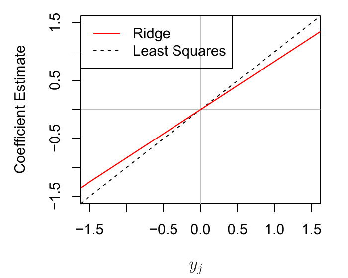{width="100%"}

[(a) Ridge: divided by $1+\lambda$ (same **proportion**)]{.panel-label}
:::
::: {.panel .center .fragment}
[$\hat\beta_j^L = \begin{cases} y_j - \lambda/2 & \text{if } y_j > \lambda/2\\ y_j + \lambda/2 & \text{if } y_j < -\lambda/2\\ 0 & \text{if } |y_j| \le \lambda/2 \end{cases}$]{.formula}

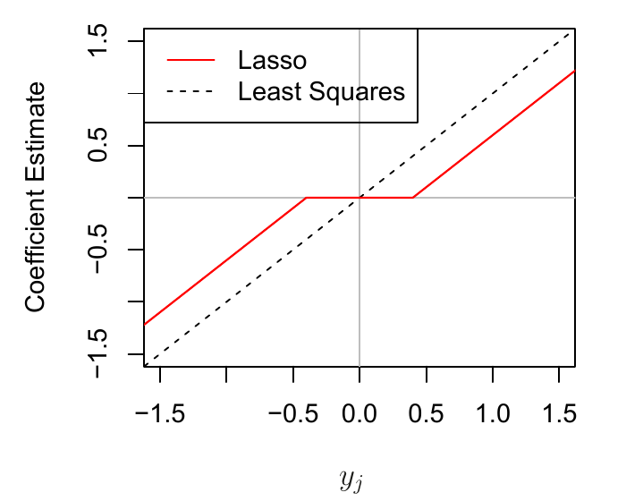{width="100%"}

[(b) Lasso: moved toward 0 by $\lambda/2$ (same **amount**)]{.panel-label}
:::
:::

[Red: ridge or lasso estimate for a fixed $\lambda$; dashed: least squares. Source: ISLP, Fig. 6.10.]{.caption}
:::
:::

::: {.fragment .result}
**Result:** the lasso sets every estimate with $|y_j| \le \lambda/2$ exactly to zero (*soft-thresholding*); this is why it performs feature selection.
:::

::: notes
- Why this set-up: with X = I, the fitted value for observation j is beta_j, so the objective is a sum of p terms that each involve a single beta_j. It can be minimized term by term, which gives closed-form solutions (6.14) and (6.15). Least squares gives beta_j = y_j, which is why the x-axis is y_j.
- Lambda is fixed within each panel; the curve shows the estimate as a function of y_j.
- Ridge: minimize (y_j - b_j)^2 + lambda b_j^2, giving y_j / (1 + lambda). Example lambda = 1: 1.0 -> 0.5, 0.2 -> 0.1, -1.2 -> -0.6. Everything halved, nothing exactly zero.
- Lasso: minimize (y_j - b_j)^2 + lambda |b_j|. Example lambda = 1 (lambda/2 = 0.5): 1.0 -> 0.5, 0.6 -> 0.1, 0.2 -> 0, -1.2 -> -0.7. Same amount subtracted; small ones snap to zero (flat segment).
- Intuition: the lasso penalty has a corner at 0, so even a tiny move away from 0 costs lambda per unit. If y_j is small, it isn't worth it.
- For a general X this holds approximately: ridge shrinks by a similar proportion, the lasso by a similar amount (p. 250).
:::

## A Bayesian view of ridge and the lasso {.smaller}

::: {.columns}
::: {.column width="32%" .fragment .setup}
**Set-up**

- Linear model with i.i.d. normal errors: $Y = \beta_0 + \sum_j X_j\beta_j + \epsilon$
- Independent prior on each coefficient: $p(\beta) = \prod_j g(\beta_j)$
- Bayes' theorem: $$p(\beta \mid X, Y) \propto f(Y \mid X, \beta)\, p(\beta)$$
:::
::: {.column width="68%" .fragment}
::: {.panels}
::: {.panel .center}
[$g$ = Gaussian]{.prior-name}

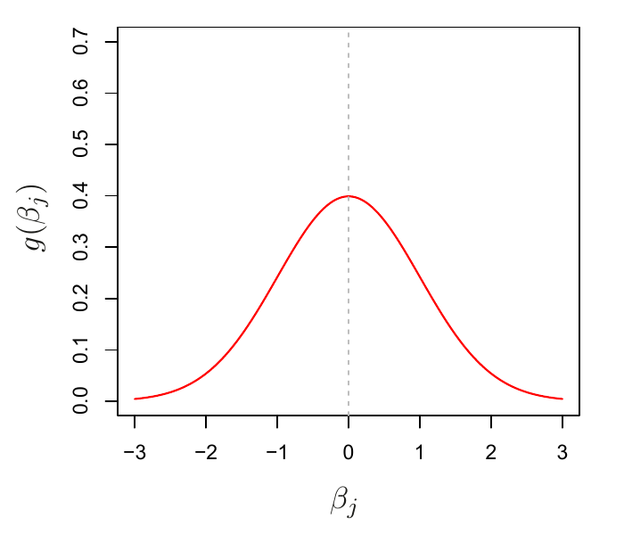{width="100%"}

[(a) Posterior mode (and mean) = **ridge**]{.panel-label}
:::
::: {.panel .center .fragment}
[$g$ = Laplace (double-exponential)]{.prior-name}

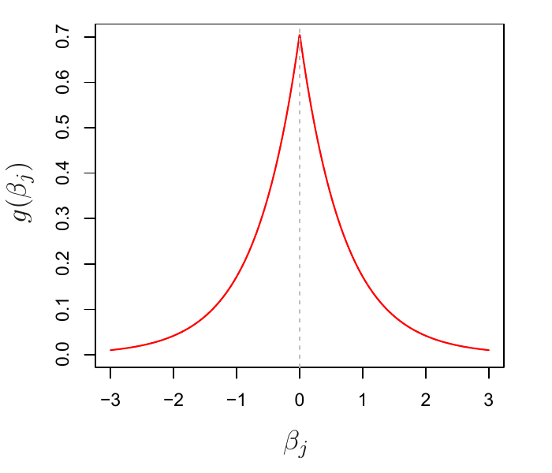{width="100%"}

[(b) Posterior mode = **lasso** (not the mean)]{.panel-label}
:::
:::

[Both priors have mean zero, with scale a function of $\lambda$. Source: ISLP, Fig. 6.11.]{.caption}
:::
:::

::: {.fragment .result}
**Result:** the Laplace prior is sharply peaked at zero, so the lasso expects *a priori* that many coefficients are exactly zero; ridge expects them to be spread around zero.
:::

::: notes
- Set-up: the usual linear model with normal errors, plus a prior g on each coefficient. Posterior is proportional to likelihood times prior (X treated as fixed).
- Gaussian prior: the posterior mode, the most likely beta given the data, is the ridge solution. It is also the posterior mean.
- Laplace prior: the posterior mode is the lasso solution. It is NOT the posterior mean, and the posterior mean is not sparse.
- Compare the shapes: Gaussian is flatter and fatter at zero; Laplace is steeply peaked at zero.
- So ridge and the lasso are not ad hoc: they follow from the linear model plus a simple prior on beta.
:::

<!-- ===== Speaker 4: Sean Murphy, "Selecting the tuning parameter" (pp. 252-253) ===== -->

## Selecting the tuning parameter: ridge example {.smaller}

Ridge and lasso both depend on $\lambda$, so we need a way to choose it from the data.

::: {.columns}
::: {.column width="36%" .fragment}
**Cross-validation**

1. Choose a range of $\lambda$ values
2. Compute the CV error for each $\lambda$
3. Select the $\lambda$ with the smallest CV error
4. Re-fit on **all** observations using $\lambda$
:::
::: {.column width="64%" .fragment .center}
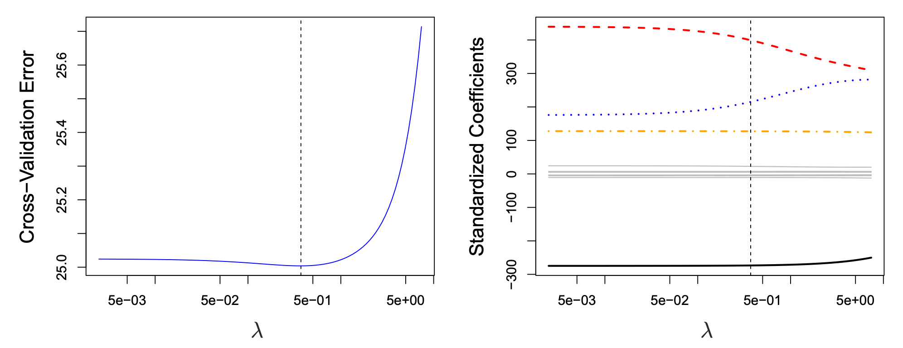{width="100%"}

[**Left Figure:** leave-one-out CV error for ridge on the Credit data. Dashed lines: selected $\lambda$. **Right Figure:** all ten coefficients, with [**Limit**]{style="color: #FF0000;"}, [**Rating**]{style="color: #0000FF;"}, [**Student**]{style="color: #FFA500;"} in color. Source: ISLP, Fig. 6.12.]{.caption}
:::
:::

::: {.fragment .result}
**Result:** the selected $\lambda$ is small and the dip is shallow, so many values give a similar error. Here we might simply use least squares.
:::

## Selecting the tuning parameter: lasso example {.smaller}

::: {.center}
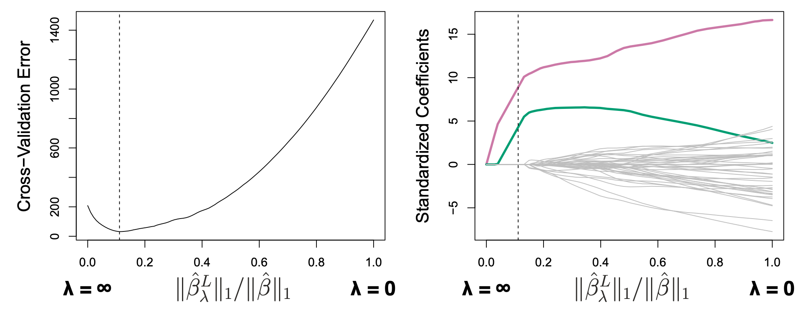{width="60%"}

[**Left Figure:** ten-fold CV error for lasso on the sparse simulated data from Fig. 6.9. Dashed lines: smallest CV error. **Right Figure:** lasso coefficients. Colored: signal variables; gray: noise variables. Source: ISLP, Fig. 6.13.]{.caption}
:::

**x-axis:** size of the lasso coefficients as a fraction of least squares.

::: {.fragment .result}
**Result:** the selected $\lambda$ beats both extremes: CV error <50, vs. ~200 for the avg response ($\lambda = \infty$) and ~1,450 for least squares ($\lambda = 0$). Only two signal variables kept, out of $p = 45$ with $n = 50$.
:::

::: {.fragment}
**Up next, the workshop:** try everything from today on real data: ridge, lasso, and choosing $\lambda$.
:::
